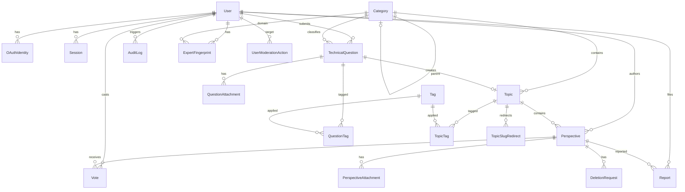
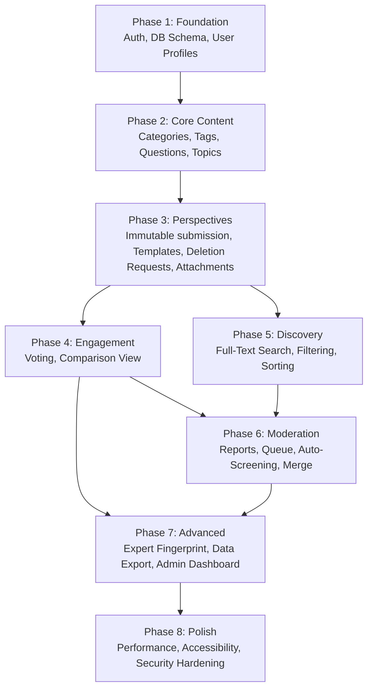

# Technical Architecture Analysis — Structured Technical Q&A Platform v1.0

> [!NOTE]
> This document is the **implementation architecture blueprint**. No application code has been generated. No SRS requirements have been modified. This serves as the implementation blueprint derived from [SRS v2.md](file:///d:/Structure%20Q&A%20Platform/SRS%20v2.md).

**Reconciliation note:** This version is aligned to the finalized product decisions: immutable Perspectives, deletion requests, upvote-only voting, server-side sessions, Kysely, localStorage drafts, local filesystem storage, development email capture/logging, npm workspaces, PostgreSQL FTS + `pg_trgm`, and a deferred Expert Fingerprint formula.

---

## Table of Contents

1. [Frontend Architecture](#1-frontend-architecture)
2. [Backend Architecture](#2-backend-architecture)
3. [Database Architecture](#3-database-architecture)
4. [API Architecture](#4-api-architecture)
5. [Authentication & Session Architecture](#5-authentication--session-architecture)
6. [RBAC Architecture](#6-rbac-architecture)
7. [File Storage Architecture](#7-file-storage-architecture)
8. [Validation & Error Handling](#8-validation--error-handling)
9. [Background Jobs / Scheduled Processing](#9-background-jobs--scheduled-processing)
10. [Search Architecture](#10-search-architecture)
11. [Testing Architecture](#11-testing-architecture)
12. [Security Architecture](#12-security-architecture)
13. [Project Directory Structure](#13-project-directory-structure)
14. [Development Sequence](#14-development-sequence)
15. [Infrastructure, Deployment & Disaster Recovery](#15-infrastructure-deployment--disaster-recovery)
16. [Deployment & Operations](#16-deployment--operations)
17. [SRS → Architecture Traceability](#17-srs--architecture-traceability)
18. [Architectural Risks & Decisions](#18-architectural-risks--decisions)
19. [Final Recommendation](#19-final-recommendation)

---

## 1. Frontend Architecture

### 1.1 Framework & Libraries

| Concern | Choice | SRS Basis |
|---|---|---|
| Framework | **React 18** (via Vite) | SW-01 (modern JS framework) |
| Styling | **Tailwind CSS** | UI-01, UI-04 (responsive 320–1920px) |
| Component Library | **Radix UI / shadcn/ui** | UI-05, QA-07 (WCAG 2.1 AA accessibility) |
| Routing | **React Router v6** | All page routes per §3.2.1 |
| Server State | **TanStack Query (React Query)** | UI-06, COM-05 (loading/error states) |
| Client State | **React Context** | Auth state, UI toggles |
| Forms | **React Hook Form + Zod** | UI-02, SEC-08 (client validation) |
| API Client | **Axios** (or fetch wrapper) | SW-07 (RESTful JSON) |
| Language | **TypeScript** | Type safety, shared types |

### 1.2 Component & Page Organization

**Layouts:**
- `MainLayout` — Navbar, Footer, Search Bar (public pages)
- `AuthLayout` — Minimal header (login, register, reset)
- `DashboardLayout` — Sidebar navigation (user/mod/admin areas)

**Feature Modules (by domain):**
- **Core:** Landing Page, Search Results, Topic View, Comparison View
- **Auth:** Login, Register, Reset Password, Verify Email, OAuth Callback
- **User:** Dashboard, Profile, Question Submission, Perspective Submission
- **Moderation:** Review Queue, Moderation Queue
- **Admin:** Admin Dashboard, User Management, System Settings, Audit Logs

### 1.3 Routing Structure

| Route | Page | Auth Required |
|---|---|---|
| `/` | Landing Page | No |
| `/auth/login` | Login | No |
| `/auth/register` | Registration | No |
| `/auth/reset-password` | Password Reset | No |
| `/auth/verify` | Email Verification | No |
| `/dashboard` | User Dashboard | Registered+ |
| `/profile` | Profile View/Edit | Registered+ |
| `/profile/:username` | Public Profile | No |
| `/questions/submit` | Question Submission | Registered+ (Verified) |
| `/topics` | Topic Listing | No |
| `/topics/:slug` | Topic View | No |
| `/topics/:slug/perspectives/submit` | Perspective Submission | Registered+ (Verified) |
| `/compare?p=id1,id2[,id3]` | Side-by-Side Comparison | No |
| `/search?q=...` | Search Results | No |
| `/mod/review-queue` | Question Review Queue | Moderator+ |
| `/mod/reports` | Moderation Queue | Moderator+ |
| `/admin/dashboard` | Admin Dashboard | Admin |
| `/admin/users` | User Management | Admin |
| `/admin/settings` | System Settings | Admin |
| `/admin/audit-logs` | Audit Log Viewer | Admin |

### 1.4 State Management

- **Server State:** TanStack Query for all API data — fetching, caching, background refetching, pagination, and optimistic updates (e.g., voting).
- **Client State:** React Context for:
  - `AuthContext` — current user, role, session validity (populated via `/api/auth/me`)
  - `UIContext` — sidebar state, theme preferences
- No Redux or Zustand needed for V1.0 scope.

### 1.5 Form Handling & Validation

- React Hook Form manages form state with minimal re-renders.
- Zod schemas are **shared** between client and server (via the `shared/` package) for consistent validation.
- Real-time feedback: required field indicators, character counters (Title: 200 chars, Description: 5,000 chars), password policy strength indicator.
- All forms validate client-side first, then server validates again (defense in depth per SEC-08).

### 1.6 API Communication

- Centralized Axios instance with:
  - Base URL configuration
  - Credentials: `withCredentials: true` (for HttpOnly cookies)
  - 10-second timeout (COM-04)
  - Response interceptor: redirect to login on 401, show toast on errors
- All API functions organized by domain in `services/` (e.g., `authService.ts`, `topicService.ts`).

### 1.7 Authentication on Frontend

- **No tokens in localStorage** — session managed entirely via HttpOnly cookies (SEC-05).
- On app load, call `GET /api/auth/me` to hydrate `AuthContext` with user data and role.
- Protected routes use a `<RequireAuth role="moderator">` wrapper component that checks `AuthContext`.
- RBAC on frontend is **UI-only convenience** — all enforcement happens server-side (SEC-06).

### 1.8 Error & Loading States

- **Loading:** Skeleton screens for page transitions; spinner overlays inside buttons for form submissions (UI-06).
- **Errors:** React Error Boundaries for unexpected crashes. Toast notifications (e.g., react-hot-toast) for API errors with error codes and actionable guidance (QA-09).
- **Empty States:** Topics with zero Perspectives show a clear empty state with a CTA to submit (FR-TOP-01).

### 1.9 Accessibility (WCAG 2.1 AA)

- Semantic HTML throughout (`<main>`, `<nav>`, `<article>`, `<section>`).
- All interactive elements have accessible labels and roles (UI-09).
- Full keyboard navigation and focus management (UI-05).
- ARIA live regions for dynamic content updates (vote counts, search results).
- Radix UI / shadcn/ui provides accessible primitives (dialogs, dropdowns, tooltips).
- Automated axe-core checks in CI; manual screen reader testing.

### 1.10 Responsive Design

- **Mobile-first** approach using Tailwind's responsive breakpoints.
- CSS Grid / Flexbox for all layouts.
- Comparison View: horizontal scroll or vertical stacking on screens < 768px (FR-CMP-01).
- Touch-friendly targets (min 44×44px) for mobile.
- Tested across 320px → 1920px (UI-04).

---

## 2. Backend Architecture

### 2.1 Framework

**Node.js 24 LTS with Express.js** (per SW-02). Express provides the minimal, well-documented foundation appropriate for a student-built V1.0 while supporting the full middleware pipeline needed.

### 2.2 Layered Architecture (QA-01 Compliance)

The backend implements a **Controller → Service → Repository** pattern — the server-side equivalent of MVC:

```
HTTP Request
  ↓
[Middleware] → Rate Limiting → Authentication → RBAC → Validation
  ↓
[Controller] → Parses request, delegates to Service, sends response
  ↓
[Service] → Business logic, orchestration, rules enforcement
  ↓
[Repository] → Database queries (parameterized), data mapping
  ↓
[PostgreSQL]
```

**How this satisfies QA-01:**
- **Model** = Repository layer + database schema (data representation and access)
- **View** = React frontend (presentation layer, completely separate)
- **Controller** = Controller layer (request/response handling) + Service layer (business logic)

This separation ensures each layer can be tested independently and has a single responsibility.

### 2.3 Layer Responsibilities

| Layer | Responsibility | Example |
|---|---|---|
| **Routes** | Define HTTP endpoints, attach middleware | `router.post('/questions', authenticate, validate(questionSchema), questionController.submit)` |
| **Controllers** | Extract request data, call services, format responses | `questionController.submit(req, res, next)` |
| **Services** | Business rules, orchestration, authorization logic | `questionService.submit(userId, data)` — validates email verified, checks rate limits, triggers content screening |
| **Repositories** | Database CRUD via parameterized queries | `questionRepository.create(data)` — inserts via query builder |
| **Middleware** | Cross-cutting concerns (auth, RBAC, validation, error handling, rate limiting) | `authenticate`, `requireRole(['moderator', 'admin'])`, `validate(schema)` |

### 2.4 Domain Organization

Controllers, services, and repositories are organized by domain:

| Domain | Controller | Service | Repository |
|---|---|---|---|
| Authentication | `authController` | `authService` | `userRepository`, `sessionRepository` |
| Users/Profiles | `userController` | `userService`, `exportService` | `userRepository` |
| Questions | `questionController` | `questionService` | `questionRepository` |
| Topics | `topicController` | `topicService` | `topicRepository` |
| Categories | `categoryController` | `categoryService` | `categoryRepository` |
| Tags | `tagController` | `tagService` | `tagRepository` |
| Perspectives | `perspectiveController` | `perspectiveService` | `perspectiveRepository`, `deletionRequestRepository` |
| Voting | `voteController` | `voteService` | `voteRepository` |
| Search | `searchController` | `searchService` | `searchRepository` |
| Reports | `reportController` | `reportService` | `reportRepository` |
| Moderation | `moderationController` | `moderationService` | Uses report/perspective/topic repos |
| Admin | `adminController` | `adminService` | Uses user/setting/auditLog repos |

### 2.5 Cross-Cutting Concerns

- **Error Handling:** Centralized `errorHandler` middleware catches all errors and maps them to standardized JSON responses. No stack traces or DB details leak (SEC-18).
- **Logging:** `pino` (structured JSON per QA-04). Audit events logged separately to the `audit_log` table (SEC-11).
- **Configuration:** `dotenv` for environment variables. System settings from DB (FR-ADM-02) loaded on startup and cached.

---

## 3. Database Architecture

### 3.1 Entity Definitions

All primary keys use **UUID v4**. Timestamps use `TIMESTAMP WITH TIME ZONE`.

---

#### **User**

| Field | Type | Constraints | Notes |
|---|---|---|---|
| `id` | UUID | PK | |
| `full_name` | VARCHAR(255) | NOT NULL | |
| `username` | VARCHAR(50) | UNIQUE, NOT NULL | Case-insensitive (CITEXT or `LOWER()` index) |
| `email` | VARCHAR(255) | UNIQUE, NOT NULL | Case-insensitive |
| `password_hash` | VARCHAR(255) | NULLABLE | NULL for OAuth-only accounts |
| `bio` | TEXT | | |
| `technical_skills` | JSONB | | Array of strings |
| `areas_of_interest` | JSONB | | Array of strings |
| `profile_picture_path` | VARCHAR(255) | | UUID-named file path |
| `email_verified` | BOOLEAN | DEFAULT false | FR-AUTH-06 |
| `email_privacy` | BOOLEAN | DEFAULT true | FR-PROF-02 (hidden by default) |
| `fingerprint_visible` | BOOLEAN | DEFAULT true | FR-PROF-02 (visible by default) |
| `role` | ENUM('user','moderator','admin') | DEFAULT 'user' | |
| `status` | ENUM('active','suspended','banned','deactivated') | DEFAULT 'active' | |
| `last_login` | TIMESTAMPTZ | | FR-AUTH-03 |
| `failed_login_attempts` | INTEGER | DEFAULT 0 | SEC-04 |
| `locked_until` | TIMESTAMPTZ | | SEC-04 |
| `created_at` | TIMESTAMPTZ | DEFAULT NOW() | |
| `updated_at` | TIMESTAMPTZ | DEFAULT NOW() | |
| `deactivated_at` | TIMESTAMPTZ | | FR-PROF-02 soft-delete |

**Indexes:**
- `UNIQUE INDEX ON LOWER(username)` — case-insensitive uniqueness
- `UNIQUE INDEX ON LOWER(email)` — case-insensitive uniqueness
- `INDEX ON status` — filter active users

---

#### **OAuthIdentity** (FR-AUTH-02)

| Field | Type | Constraints | Notes |
|---|---|---|---|
| `id` | UUID | PK | |
| `user_id` | UUID | FK → User, NOT NULL | |
| `provider` | ENUM('google','github') | NOT NULL | |
| `provider_user_id` | VARCHAR(255) | NOT NULL | Stable identifier per FR-AUTH-02 |
| `provider_email` | VARCHAR(255) | | Email reported by provider |
| `created_at` | TIMESTAMPTZ | DEFAULT NOW() | |

**Constraints:** `UNIQUE(provider, provider_user_id)`

---

#### **Session** (FR-AUTH-07) — Managed by `connect-pg-simple`

> [!IMPORTANT]
> **No custom Session entity is defined.** Sessions are managed entirely by the `connect-pg-simple` library, which automatically creates and maintains its own `session` table in PostgreSQL with the schema:

| Field | Type | Notes |
|---|---|---|
| `sid` | VARCHAR | PK — session ID (generated by `express-session`) |
| `sess` | JSON | NOT NULL — serialized session data (contains `userId`, `role`, `status`, `ip`, `userAgent`) |
| `expire` | TIMESTAMPTZ | NOT NULL — session expiration timestamp |

**How this works end-to-end:**
- `express-session` generates a session ID, stores it in an HttpOnly/Secure/SameSite=Lax cookie.
- `connect-pg-simple` persists session data in the `session` table — no custom `token_hash` column needed.
- **Logout (FR-AUTH-04):** `req.session.destroy()` deletes the row from the `session` table.
- **Logout all devices (FR-AUTH-07):** `DELETE FROM session WHERE sess->>'userId' = ?` removes all sessions for a user.
- **Password reset invalidation (FR-AUTH-05):** Same `DELETE` query as logout-all.
- **Inactivity timeout:** `express-session` with `rolling: true` and `maxAge: 3600000` (60 min) handles sliding expiration. `connect-pg-simple` prunes expired rows automatically via `pruneSessionInterval`.
- **Migrations:** The `connect-pg-simple` setup script creates the `session` table. No custom migration is needed.

**Index:** `CREATE INDEX idx_session_expire ON session (expire)` — created automatically by `connect-pg-simple`.

---

#### **TechnicalQuestion** (FR-QST-01 – FR-QST-03, FR-MOD-04)

| Field | Type | Constraints | Notes |
|---|---|---|---|
| `id` | UUID | PK | |
| `submitter_id` | UUID | FK → User, NOT NULL | |
| `title` | VARCHAR(200) | NOT NULL | |
| `description` | TEXT | NOT NULL | Max 5,000 chars (app-enforced) |
| `category_id` | UUID | FK → Category, NOT NULL | |
| `tech_stack` | JSONB | | Optional |
| `status` | ENUM('pending','approved','rejected') | DEFAULT 'pending' | FR-QST-03 |
| `rejection_reason` | TEXT | | Required on reject |
| `approval_outcome` | ENUM('linked_topic','new_topic') | NULLABLE | Set on approval |
| `linked_topic_id` | UUID | FK → Topic, NULLABLE | |
| `reviewer_id` | UUID | FK → User, NULLABLE | |
| `reviewed_at` | TIMESTAMPTZ | | |
| `screening_status` | ENUM('pending','clean','flagged') | DEFAULT 'pending' | FR-MOD-04 — set by the content screening job |
| `is_flagged` | BOOLEAN | DEFAULT false | FR-MOD-04 — convenience flag for queries |
| `flag_reasons` | JSONB | | FR-MOD-04 — array of `{rule, detail, score}` objects |
| `screened_at` | TIMESTAMPTZ | | FR-MOD-04 — when screening last ran |
| `created_at` | TIMESTAMPTZ | DEFAULT NOW() | |
| `updated_at` | TIMESTAMPTZ | DEFAULT NOW() | |
| `deleted_at` | TIMESTAMPTZ | | Soft-delete while pending |

**Indexes:** `INDEX ON status` (review queue), `INDEX ON submitter_id` (user's questions), `INDEX ON screening_status` (flagged content queue)

---

#### **Topic** (FR-TOP-01 – FR-TOP-04)

| Field | Type | Constraints | Notes |
|---|---|---|---|
| `id` | UUID | PK | |
| `title` | VARCHAR(255) | UNIQUE, NOT NULL | |
| `slug` | VARCHAR(255) | UNIQUE, NOT NULL | Auto-generated, collision-resolved (FR-TOP-01) |
| `description` | TEXT | NOT NULL | |
| `category_id` | UUID | FK → Category, NOT NULL | |
| `is_curated` | BOOLEAN | DEFAULT false | Manual vs Question-derived |
| `status` | ENUM('published','archived','hidden') | DEFAULT 'published' | |
| `source_question_id` | UUID | FK → TechnicalQuestion, NULLABLE | |
| `created_by` | UUID | FK → User, NOT NULL | |
| `perspective_count` | INTEGER | DEFAULT 0 | Denormalized for sorting |
| `created_at` | TIMESTAMPTZ | DEFAULT NOW() | |
| `updated_at` | TIMESTAMPTZ | DEFAULT NOW() | |

**Indexes:** `UNIQUE INDEX ON slug`, `INDEX ON status`, `INDEX ON category_id`, GIN index on `tsvector` for search

---

#### **Category** (FR-TOP-05, FR-PSP-01 — Template Definition)

| Field | Type | Constraints | Notes |
|---|---|---|---|
| `id` | UUID | PK | |
| `name` | VARCHAR(100) | UNIQUE, NOT NULL | |
| `description` | TEXT | | |
| `parent_id` | UUID | FK → Category (self), NULLABLE | Hierarchical; circularity prevented in app logic |
| `is_active` | BOOLEAN | DEFAULT true | Soft deactivation |
| `template_schema` | JSONB | NOT NULL, DEFAULT (see below) | Defines the structured Perspective template for this Category |
| `created_at` | TIMESTAMPTZ | DEFAULT NOW() | |
| `updated_at` | TIMESTAMPTZ | DEFAULT NOW() | |

**Constraint:** `CHECK (parent_id != id)` — prevent self-referencing

##### Category-Specific Perspective Templates (FR-PSP-01)

> [!IMPORTANT]
> The SRS requires "The system shall display a template based on the Topic's Category" (FR-PSP-01). Rather than hardcoding Perspective columns, each Category defines a `template_schema` that controls which fields are shown, required, and how they are validated.

**`template_schema` structure (JSONB):**
```json
{
  "sections": [
    {
      "key": "proposed_solution",
      "label": "Proposed Solution",
      "type": "richtext",
      "required": true,
      "maxLength": 10000
    },
    {
      "key": "explanation",
      "label": "Explanation",
      "type": "richtext",
      "required": true,
      "maxLength": 10000
    },
    {
      "key": "advantages",
      "label": "Advantages",
      "type": "list",
      "required": true,
      "minItems": 1
    },
    {
      "key": "limitations",
      "label": "Limitations",
      "type": "list",
      "required": true,
      "minItems": 1
    },
    {
      "key": "code_snippets",
      "label": "Code Snippets",
      "type": "code",
      "required": false
    },
    {
      "key": "references",
      "label": "References",
      "type": "url_list",
      "required": false
    }
  ]
}
```

**How the template pipeline works:**

```
1. Admin/Mod creates Category → defines template_schema (or uses default)
2. User opens "Submit Perspective" for a Topic
3. Frontend: GET /api/categories/:id/template → receives template_schema
4. Frontend: Dynamically renders form fields from template_schema sections
5. User fills in the form → frontend validates against template_schema
6. POST /api/topics/:topicId/perspectives → sends { content: { ... } }
7. Backend: Loads the Topic's Category → loads template_schema
8. Backend: Validates submitted content against template_schema
   - All required sections present?
   - Field types correct? (richtext, list, code, url_list)
   - Length/count constraints met?
9. Stores validated content in Perspective.content (JSONB)
```

**Field types supported in V1.0:**
| Type | UI Rendering | Validation |
|---|---|---|
| `richtext` | Textarea with markdown support | Required + maxLength |
| `list` | Dynamic list of text items (add/remove) | Required + minItems |
| `code` | Code editor with language selector | Array of `{language, code}` |
| `url_list` | List of URL inputs | Valid URL format |

**Default template:** Every Category gets the standard 6-section template shown above (matching the SRS baseline). Admins can customize per-Category (e.g., a "Debugging" category might add a `steps_to_reproduce` section, a "Technology Comparison" category might add `performance_benchmarks`).

---

#### **Tag** (FR-TOP-06)

| Field | Type | Constraints | Notes |
|---|---|---|---|
| `id` | UUID | PK | |
| `name` | VARCHAR(50) | UNIQUE, NOT NULL | Case-insensitive (CITEXT or `LOWER()` index) |
| `is_active` | BOOLEAN | DEFAULT true | |
| `created_at` | TIMESTAMPTZ | DEFAULT NOW() | |
| `updated_at` | TIMESTAMPTZ | DEFAULT NOW() | |

---

#### **Junction Tables (Many-to-Many)**

- **TopicTag:** `topic_id` (FK → Topic), `tag_id` (FK → Tag). **PK(topic_id, tag_id)**
- **QuestionTag:** `question_id` (FK → TechnicalQuestion), `tag_id` (FK → Tag). **PK(question_id, tag_id)** — max 5 tags enforced in app logic

---

#### **QuestionAttachment**

| Field | Type | Constraints | Notes |
|---|---|---|---|
| `id` | UUID | PK | |
| `question_id` | UUID | FK → TechnicalQuestion, NOT NULL | |
| `file_path` | VARCHAR(255) | NOT NULL | UUID-based path on disk |
| `original_filename` | VARCHAR(255) | NOT NULL | Display name |
| `mime_type` | VARCHAR(100) | NOT NULL | Validated MIME |
| `size_bytes` | BIGINT | NOT NULL | |
| `created_at` | TIMESTAMPTZ | DEFAULT NOW() | |

---

#### **Perspective** (FR-PSP-01, FR-PSP-03, FR-MOD-04)

| Field | Type | Constraints | Notes |
|---|---|---|---|
| `id` | UUID | PK | |
| `topic_id` | UUID | FK → Topic, NOT NULL | |
| `author_id` | UUID | FK → User, NOT NULL | |
| `content` | JSONB | NOT NULL | Template-driven content validated against the Topic Category's `template_schema`. |
| `hidden_by_mod` | BOOLEAN | DEFAULT false | Moderation hiding (FR-MOD-02). |
| `is_deleted` | BOOLEAN | DEFAULT false | Administrative deletion state after approved deletion request or direct admin action. |
| `deleted_by` | UUID | FK → User, NULLABLE | Administrator/moderator actor where applicable. |
| `deletion_reason` | TEXT | NULLABLE | Reason recorded for administrative deletion. |
| `screening_status` | ENUM('pending','clean','flagged') | DEFAULT 'pending' | FR-MOD-04. |
| `is_flagged` | BOOLEAN | DEFAULT false | Convenience flag for moderation queries. |
| `flag_reasons` | JSONB | | Array of screening reasons. |
| `screened_at` | TIMESTAMPTZ | | When screening last ran. |
| `upvote_count` | INTEGER | DEFAULT 0 | Denormalized total of active upvotes. |
| `created_at` | TIMESTAMPTZ | DEFAULT NOW() | |
| `updated_at` | TIMESTAMPTZ | DEFAULT NOW() | |

**Indexes:** `INDEX ON topic_id`, `INDEX ON author_id`, `INDEX ON upvote_count DESC`, `INDEX ON screening_status`, GIN index on `tsvector` for search.

> [!IMPORTANT]
> **Perspectives are immutable after submission.** There is no Perspective edit operation, version history, version restore, or author-direct deletion. The submitted content remains unchanged for its lifetime.

**Deletion workflow:** An author submits a deletion request with a mandatory reason. The request enters the administrative review queue while the Perspective remains publicly visible. An Administrator may approve the request and soft-delete the Perspective, or may directly soft-delete a Perspective when required. Hard deletion is reserved for legal/severe policy cases and permanently removes the Perspective and associated attachments while retaining an immutable audit record.

#### **PerspectiveAttachment**

Same structure as `QuestionAttachment` but with `perspective_id` FK → Perspective.

#### **DeletionRequest** (FR-PSP-03)

| Field | Type | Constraints | Notes |
|---|---|---|---|
| `id` | UUID | PK | |
| `perspective_id` | UUID | FK → Perspective, NOT NULL | Perspective requested for deletion |
| `requester_id` | UUID | FK → User, NOT NULL | Must equal Perspective author |
| `reason` | TEXT | NOT NULL | Mandatory reason supplied by author |
| `status` | ENUM('pending','approved','rejected') | DEFAULT 'pending' | Administrative review state |
| `reviewer_id` | UUID | FK → User, NULLABLE | Administrator who reviewed the request |
| `reviewer_reason` | TEXT | NULLABLE | Optional administrative note |
| `created_at` | TIMESTAMPTZ | DEFAULT NOW() | |
| `reviewed_at` | TIMESTAMPTZ | | |

**Constraint:** Only one active (`pending`) deletion request per Perspective. The Perspective remains publicly visible while the request is pending.

---

#### **Vote** (FR-VOTE-01)

| Field | Type | Constraints | Notes |
|---|---|---|---|
| `id` | UUID | PK | |
| `perspective_id` | UUID | FK → Perspective, NOT NULL | |
| `user_id` | UUID | FK → User, NOT NULL | |
| `vote` | BOOLEAN | NOT NULL | |
| `created_at` | TIMESTAMPTZ | DEFAULT NOW() | |
| `updated_at` | TIMESTAMPTZ | DEFAULT NOW() | |

**Constraint:** `UNIQUE(perspective_id, user_id)` — enforces one vote per user per Perspective at the DB level (FR-VOTE-01). Self-voting prevention enforced in service layer (`author_id != user_id`).

---

#### **Report** (FR-MOD-01)

| Field | Type | Constraints | Notes |
|---|---|---|---|
| `id` | UUID | PK | |
| `reporter_id` | UUID | FK → User, NOT NULL | |
| `content_type` | ENUM('topic','perspective') | NOT NULL | |
| `content_id` | UUID | NOT NULL | Polymorphic reference |
| `reason` | ENUM('spam','offensive','duplicate','misleading','plagiarism','other') | NOT NULL | FR-MOD-01 |
| `additional_comments` | TEXT | | |
| `status` | ENUM('open','under_review','resolved','dismissed') | DEFAULT 'open' | FR-MOD-02 |
| `moderator_id` | UUID | FK → User, NULLABLE | |
| `moderator_notes` | TEXT | | |
| `created_at` | TIMESTAMPTZ | DEFAULT NOW() | |
| `updated_at` | TIMESTAMPTZ | DEFAULT NOW() | |

**Constraint:** `UNIQUE(reporter_id, content_type, content_id)` — one report per user per item (FR-MOD-01)

---

#### **AuditLog** (FR-ADM-03, SEC-11)

| Field | Type | Constraints | Notes |
|---|---|---|---|
| `id` | UUID | PK | |
| `timestamp` | TIMESTAMPTZ | DEFAULT NOW(), NOT NULL | Immutable |
| `actor_id` | UUID | FK → User, NULLABLE | NULL for system events |
| `action` | VARCHAR(100) | NOT NULL | e.g., 'user.login', 'topic.merge', 'perspective.delete' |
| `target_type` | VARCHAR(100) | NOT NULL | Entity type |
| `target_id` | VARCHAR(255) | NOT NULL | Entity ID |
| `ip_address` | INET | | |
| `result` | VARCHAR(50) | NOT NULL | 'success' or 'failure' |
| `details` | JSONB | | Metadata — **no passwords, tokens, or raw PII** (SEC-11) |

**Design:** Append-only. The application database user is granted `INSERT` and `SELECT` only on this table — no `UPDATE` or `DELETE` permissions. 1-year retention enforced via scheduled cleanup (SEC-11). Partitioned by month for query performance.

---

#### **ExpertFingerprint** (FR-EXP-01)

| Field | Type | Constraints | Notes |
|---|---|---|---|
| `user_id` | UUID | FK → User | Composite PK |
| `category_id` | UUID | FK → Category | Composite PK |
| `perspective_count` | INTEGER | DEFAULT 0 | |
| `total_upvote_count` | INTEGER | DEFAULT 0 | |
| `weighted_score` | FLOAT | DEFAULT 0.0 | Implementation-defined formula |
| `last_calculated` | TIMESTAMPTZ | DEFAULT NOW() | |

**PK:** `(user_id, category_id)`. Recalculated daily via background job.

---

#### **Supporting Entities**

| Entity | Key Fields | Purpose |
|---|---|---|
| **PasswordResetToken** | `id`, `user_id` FK, `token_hash`, `expires_at` (30 min), `used` BOOLEAN | FR-AUTH-05, SEC-02 |
| **EmailVerificationToken** | `id`, `user_id` FK, `token_hash`, `expires_at` (24 hr), `used` BOOLEAN | FR-AUTH-06 |
| **TopicSlugRedirect** | `id`, `old_slug`, `topic_id` FK | FR-TOP-02 (redirect after slug change) |
| **SystemSetting** | `key` (PK), `value` JSONB, `updated_by` FK, `updated_at` | FR-ADM-02 |
| **Draft** | Client-side localStorage object, not a server database entity | SAF-07 (autosave every 60s) |

---

#### **UserModerationAction** (FR-MOD-03)

| Field | Type | Constraints | Notes |
|---|---|---|---|
| `id` | UUID | PK | |
| `user_id` | UUID | FK → User, NOT NULL | Target user |
| `actor_id` | UUID | FK → User, NOT NULL | Moderator/Admin who took action |
| `action` | ENUM('warning','suspension','ban','unsuspend','unban') | NOT NULL | FR-MOD-03 |
| `reason` | TEXT | NOT NULL | Required explanation |
| `expires_at` | TIMESTAMPTZ | NULLABLE | Required for 'suspension' — when the suspension lifts. NULL for permanent actions (ban/warning). |
| `is_active` | BOOLEAN | DEFAULT true | Set to false when expired or manually reversed |
| `created_at` | TIMESTAMPTZ | DEFAULT NOW() | |

**Indexes:** `INDEX ON user_id` (lookup history), `INDEX ON (user_id, action, is_active)` (check active suspensions)

**Design:**
- On **Suspend**: Insert row with `action='suspension'`, `expires_at` set. Update `User.status = 'suspended'`. Background job or login-time check: if `expires_at < NOW()`, auto-set `is_active = false` and restore `User.status = 'active'`.
- On **Ban**: Insert row with `action='ban'`, `expires_at = NULL`. Update `User.status = 'banned'`.
- On **Unsuspend/Unban**: Insert new row with `action='unsuspend'/'unban'`. Set prior active action's `is_active = false`. Restore `User.status = 'active'`.
- On **Warning**: Insert row with `action='warning'`. No status change. Visible to admins on the user management page.
- Full history is preserved — each action is a separate row. This replaces the single `POST /api/admin/users/:id/action` "black box" with a queryable moderation history.

---

### 3.2 Relationship Summary



### 3.3 Special Design Considerations

- **Soft-Delete & Anonymization (FR-PROF-02, SEC-14):** On account deactivation, PII is scrubbed while published Questions and Perspectives are retained under anonymised authorship and existing upvotes remain intact.
- **Voting Constraints (FR-VOTE-01):** DB-level `UNIQUE(perspective_id, user_id)` prevents race-condition duplicates. Vote count updates use transactions.
- **Audit Log (SEC-11):** Append-only via DB permissions. No passwords, tokens, or full PII in the `details` JSONB.

---

## 4. API Architecture

All endpoints use RESTful conventions with JSON payloads (SW-07). Rate limiting is applied globally (SEC-03). OpenAPI 3.0 documentation will be generated (SW-08).

### 4.1 Authentication

| Method | Endpoint | Auth | Purpose | SRS |
|---|---|---|---|---|
| POST | `/api/auth/register` | None | Local registration | FR-AUTH-01 |
| POST | `/api/auth/login` | None | Local login (rate limited: 5 fails/15min) | FR-AUTH-03, SEC-04 |
| POST | `/api/auth/logout` | Registered+ | Invalidate session | FR-AUTH-04 |
| POST | `/api/auth/logout-all` | Registered+ | Revoke all sessions | FR-AUTH-07 |
| POST | `/api/auth/verify-email` | None | Verify email token | FR-AUTH-06 |
| POST | `/api/auth/resend-verification` | None | Resend verification (5-min cooldown) | FR-AUTH-06 |
| POST | `/api/auth/forgot-password` | None | Request password reset | FR-AUTH-05 |
| POST | `/api/auth/reset-password` | None | Reset password with token | FR-AUTH-05 |
| GET | `/api/auth/me` | Registered+ | Get current user session | FR-AUTH-07 |
| GET | `/api/auth/oauth/:provider` | None | Initiate OAuth flow | FR-AUTH-02 |
| GET | `/api/auth/oauth/:provider/callback` | None | OAuth callback | FR-AUTH-02 |

### 4.2 Users / Profiles

| Method | Endpoint | Auth | Purpose | SRS |
|---|---|---|---|---|
| GET | `/api/users/:username` | None | View public profile | FR-PROF-01 |
| PATCH | `/api/users/me` | Registered+ | Update profile/privacy settings | FR-PROF-01, FR-PROF-02 |
| PUT | `/api/users/me/password` | Registered+ | Change password | FR-PROF-01 |
| POST | `/api/users/me/profile-picture` | Registered+ | Upload profile picture (2MB, JPEG/PNG) | FR-PROF-01 |
| POST | `/api/users/me/deactivate` | Registered+ | Deactivate account (soft-delete) | FR-PROF-02, SEC-14 |
| GET | `/api/users/me/votes` | Registered+ | Voting history (paginated, includes perspective summaries) — used by dashboard | FR-VOTE-01 |
| GET | `/api/users/me/expert-fingerprint` | Registered+ | Current user's Expert Fingerprint across categories | FR-EXP-02 |

#### Data Export (FR-PROF-03, SEC-13)

| Method | Endpoint | Auth | Purpose | SRS |
|---|---|---|---|---|
| POST | `/api/users/me/export` | Registered+ | Request data export — queues background job | FR-PROF-03 |
| GET | `/api/users/me/export/status` | Registered+ | Check export job status (pending/processing/ready/expired) | FR-PROF-03 |
| GET | `/api/users/me/export/download` | Registered+ | Download completed export via signed, time-limited token | FR-PROF-03, SEC-13 |

**Data export pipeline:**
```
1. POST /api/users/me/export → creates DataExport record (status: pending)
   → queues pg-boss job → returns 202 Accepted with exportId

2. Background job (dataExportJob):
   → Collects all user data (profile, questions, perspectives, votes, attachments)
   → Generates ZIP archive to secure temporary storage (outside web root)
   → Generates a signed download token (HMAC with expiry)
   → Updates DataExport record: status = ready, expires_at = NOW + 48h
   → Sends email notification with download link

3. GET /api/users/me/export/download?token=<signed_token>
   → Validates signed token (checks HMAC, expiry, ownership)
   → Streams ZIP file with Content-Disposition: attachment
   → Must complete within 72h of request (FR-PROF-03)

4. Expiration:
   → Background cleanup job deletes ZIP files where expires_at < NOW
   → DataExport record updated: status = expired
```

### 4.3 Questions

| Method | Endpoint | Auth | Purpose | SRS |
|---|---|---|---|---|
| POST | `/api/questions` | Registered+ (Verified) | Submit question (multipart for attachments) | FR-QST-01 |
| GET | `/api/questions/mine` | Registered+ | List own questions (all statuses) | FR-QST-01 |
| GET | `/api/questions/:id` | None | View approved question (public — per FR-QST-03: "the original Question shall remain publicly visible alongside the Topic as the source Question/reference"). Returns 404 for pending/rejected questions when accessed by non-moderators. | FR-QST-03 |
| PATCH | `/api/questions/:id` | Owner (Pending only) | Edit pending question | FR-QST-01 |
| DELETE | `/api/questions/:id` | Owner (Pending only) | Delete pending question | FR-QST-01 |
| GET | `/api/questions/review-queue` | Moderator+ | List pending questions for review | FR-QST-02 |
| GET | `/api/questions/:id/review` | Moderator+ | View full question details for review (includes pending/rejected questions, submitter info, attachments) | FR-QST-02 |
| POST | `/api/questions/:id/review` | Moderator+ | Approve/Reject (payload: action, reason, topicId) | FR-QST-02 |

> [!NOTE]
> **Visibility logic for `GET /api/questions/:id`:** The service layer checks `question.status`:
> - **Approved:** Return full question data to any caller (Guest or Registered). The question is displayed alongside its linked Topic.
> - **Pending/Rejected:** Return 404 to Guests and Registered Users. Moderators and Admins use the separate `/review` sub-endpoint to access these.

### 4.4 Topics

| Method | Endpoint | Auth | Purpose | SRS |
|---|---|---|---|---|
| GET | `/api/topics` | None | List published topics (paginated, filterable) | FR-SRCH-01 |
| GET | `/api/topics/:slug` | None | Get topic by slug (with redirect handling) | FR-TOP-01 |
| POST | `/api/topics` | Moderator+ | Create curated topic | FR-TOP-01 |
| PATCH | `/api/topics/:id` | Moderator+ | Edit topic metadata | FR-TOP-02 |
| POST | `/api/topics/:id/archive` | Moderator+ | Archive topic | FR-TOP-04 |
| POST | `/api/topics/merge` | **Admin only** | Merge source → destination | FR-TOP-03 |

### 4.5 Categories & Tags

| Method | Endpoint | Auth | Purpose | SRS |
|---|---|---|---|---|
| GET | `/api/categories` | None | List active categories (with hierarchy) | FR-TOP-05 |
| POST | `/api/categories` | Moderator+ | Create category | FR-TOP-05 |
| PATCH | `/api/categories/:id` | Moderator+ | Edit category | FR-TOP-05 |
| DELETE | `/api/categories/:id` | Moderator+ | Deactivate category (soft) | FR-TOP-05 |
| GET | `/api/tags` | None | List active tags | FR-TOP-06 |
| POST | `/api/tags` | Moderator+ | Create tag | FR-TOP-06 |
| PATCH | `/api/tags/:id` | Moderator+ | Rename tag | FR-TOP-06 |
| POST | `/api/tags/merge` | Moderator+ | Merge tags | FR-TOP-06 |
| DELETE | `/api/tags/:id` | Moderator+ | Deactivate tag | FR-TOP-06 |

### 4.6 Perspectives

| Method | Endpoint | Auth | Purpose | SRS |
|---|---|---|---|---|
| GET | `/api/topics/:topicId/perspectives` | None | List perspectives for a topic | FR-PSP-01 |
| POST | `/api/topics/:topicId/perspectives` | Registered+ (Verified) | Submit perspective (multipart) | FR-PSP-01 |
| GET | `/api/perspectives/:id` | None | Get single perspective | FR-PSP-01 |
| POST | `/api/perspectives/:id/deletion-request` | Owner | Submit deletion request with mandatory reason | FR-PSP-03 |
| POST | `/api/perspectives/:id/admin-delete` | **Admin only** | Administrative soft-delete (with reason) | FR-PSP-03 |
| POST | `/api/perspectives/:id/hard-delete` | **Admin only** | Hard-delete for legal/severe violations | FR-PSP-03 |

### 4.7 Voting

| Method | Endpoint | Auth | Purpose | SRS |
|---|---|---|---|---|
| POST | `/api/perspectives/:id/upvote` | Registered+ | Add/toggle an upvote | FR-VOTE-01 |
| DELETE | `/api/perspectives/:id/upvote` | Registered+ | Remove the user's upvote | FR-VOTE-01 |

### 4.8 Comparison

| Method | Endpoint | Auth | Purpose | SRS |
|---|---|---|---|---|
| GET | `/api/perspectives/compare?ids=id1,id2[,id3]` | None | Compare 2–3 perspectives (same topic) | FR-CMP-01 |

### 4.9 Search & Filtering

| Method | Endpoint | Auth | Purpose | SRS |
|---|---|---|---|---|
| GET | `/api/search?q=&category=&tags=&dateFrom=&dateTo=&author=&minScore=&sort=&page=` | None | Full-text search with filters | FR-SRCH-01, FR-SRCH-02 |

### 4.10 Reports & Moderation

| Method | Endpoint | Auth | Purpose | SRS |
|---|---|---|---|---|
| POST | `/api/reports` | Registered+ | Report content | FR-MOD-01 |
| GET | `/api/reports` | Moderator+ | List reports (filterable by status) | FR-MOD-02 |
| GET | `/api/reports/:id` | Moderator+ | View report details | FR-MOD-02 |
| POST | `/api/reports/:id/action` | Moderator+ | Take action (dismiss/hide/escalate) | FR-MOD-02 |

### 4.11 Administration

| Method | Endpoint | Auth | Purpose | SRS |
|---|---|---|---|---|
| GET | `/api/admin/users` | Admin | List/search/filter users | FR-ADM-01 |
| PATCH | `/api/admin/users/:id/role` | Admin | Change user role | FR-ADM-01 |
| POST | `/api/admin/users/:id/moderation-actions` | Moderator+ | Issue moderation action: `{action: "warning"/"suspension"/"ban"/"unsuspend"/"unban", reason, expiresAt?}`. Creates `UserModerationAction` record and updates `User.status`. | FR-MOD-03 |
| GET | `/api/admin/users/:id/moderation-actions` | Moderator+ | View moderation history for a user | FR-MOD-03 |
| POST | `/api/admin/users/:id/deactivate` | Admin | Admin-initiated deactivation | FR-ADM-01, SEC-14 |
| GET | `/api/admin/settings` | Admin | Get all system settings | FR-ADM-02 |
| PATCH | `/api/admin/settings` | Admin | Update system settings (validated against allowed keys/types) | FR-ADM-02 |
| GET | `/api/admin/audit-logs` | Admin | View/filter audit logs | FR-ADM-03 |
| GET | `/api/admin/analytics/overview` | Admin | Dashboard analytics: total users, topics, perspectives, questions by status, active reports, new registrations over time, top categories, content submission trends | FR-ADM-01 |

### 4.12 File Access

| Method | Endpoint | Auth | Purpose | SRS |
|---|---|---|---|---|
| GET | `/api/files/:fileId` | Varies | Serve file through app (not static) | SEC-09 |

---

## 5. Authentication & Session Architecture

### 5.1 Mechanism Decision: Server-Side Sessions

> [!IMPORTANT]
> **Server-side sessions** (via `express-session` + `connect-pg-simple`) are recommended over JWT-based stateless sessions for V1.0. The SRS requires "logout from all devices" (FR-AUTH-07) and "invalidate all sessions after password change" (FR-AUTH-05) — both are trivial with server-side sessions (`DELETE FROM sessions WHERE user_id = ?`) but complex with stateless JWTs.

**Session cookie configuration:**
- `HttpOnly: true` — prevents JavaScript access
- `Secure: true` — HTTPS only
- `SameSite: 'Lax'` — CSRF protection
- `maxAge: SettingsService.get('auth.session.maxAgeMs')` — default 3600000 (60 min), admin-configurable (FR-ADM-02, FR-AUTH-07)

### 5.2 Authentication Flows

#### Local Registration (FR-AUTH-01)
```
User → POST /api/auth/register {fullName, username, email, password, confirmPassword}
  → Validate all fields (Zod schema)
  → Check username/email uniqueness (case-insensitive)
  → Enforce password policy (SettingsService: minLength default 12, upper+lower+digit+special)
  → Hash password with Argon2id (SEC-01)
  → Insert user (email_verified = false)
  → Generate verification token → hash → store in EmailVerificationToken
  → Queue verification email (background job)
  → Return generic success (no account enumeration — SEC-18)
```

#### Email Verification (FR-AUTH-06)
```
User → POST /api/auth/verify-email {token}
  → Hash token → lookup in EmailVerificationToken
  → Check not expired (24h) and not used
  → Mark email_verified = true
  → Mark token as used
```

#### Local Login (FR-AUTH-03, SEC-04)
```
User → POST /api/auth/login {emailOrUsername, password}
  → Check account lockout (locked_until > NOW → reject)
  → Find user by email or username (case-insensitive)
  → Verify password against Argon2id hash
  → On failure: increment failed_login_attempts; if ≥ 5, set locked_until = NOW + 15min
  → On success: reset failed_login_attempts, update last_login
  → Check email_verified = true (reject if not)
  → Check status != suspended/banned
  → Create server-side session → set HttpOnly cookie
  → Log attempt in audit log (excluding password)
```

#### OAuth Flow (FR-AUTH-02)
```
User → GET /api/auth/oauth/:provider
  → Generate cryptographic state parameter (CSRF protection)
  → Generate cryptographic nonce parameter (replay protection)
  → Store both in server-side session: { oauthState, oauthNonce }
  → Redirect to provider authorization URL with state and nonce parameters

Provider callback → GET /api/auth/oauth/:provider/callback {code, state}
  → Validate state parameter matches session.oauthState (reject if mismatch → CSRF)
  → Exchange authorization code for tokens
  → For OIDC providers (Google): validate ID token claims:
      - Verify iss (issuer), aud (client ID), exp (expiration)
      - Verify nonce in ID token matches session.oauthNonce (reject if mismatch → replay)
  → For non-OIDC providers (GitHub): validate via user info endpoint
  → Clear session.oauthState and session.oauthNonce (single-use)
  → Extract provider_user_id, email, name, profile picture
  → Lookup OAuthIdentity by (provider, provider_user_id)
  → If found: log in existing user
  → If not found + email exists + provider-verified email: link to existing account
  → If not found + new email: create new user account
  → Create session
```

#### Password Reset (FR-AUTH-05)
```
User → POST /api/auth/forgot-password {email}
  → Always return generic success (prevent enumeration)
  → If email exists: generate single-use token → hash → store (30-min expiry)
  → Queue password reset email

User → POST /api/auth/reset-password {token, newPassword, confirmPassword}
  → Hash token → lookup → check not expired and not used
  → Validate new password meets policy
  → Hash new password with Argon2id
  → Update user password_hash
  → Mark token as used
  → DELETE all sessions for this user (FR-AUTH-05: invalidate all active sessions)
```

#### Logout (FR-AUTH-04, FR-AUTH-07)
```
POST /api/auth/logout → destroy current session, clear cookie
POST /api/auth/logout-all → DELETE all sessions WHERE user_id = current user
```

---

## 6. RBAC Architecture

### 6.1 Role Permission Matrix (from Appendix B)

| Action | Guest | Registered | Moderator | Admin |
|---|:---:|:---:|:---:|:---:|
| View Topics & Perspectives | ✅ | ✅ | ✅ | ✅ |
| Search & Filter | ✅ | ✅ | ✅ | ✅ |
| Compare Perspectives | ✅ | ✅ | ✅ | ✅ |
| Register / Login | ✅ | — | — | — |
| Submit Technical Question | ❌ | ✅ | ✅ | ✅ |
| Edit/Delete own pending Question | ❌ | ✅ | ✅ | ✅ |
| Submit Perspective | ❌ | ✅ | ✅ | ✅ |
| Edit/Delete own Perspective | ❌ | ❌ | ❌ | ✅ |
| View own deletion-request history | ❌ | ✅ | ✅ | ✅ |
| Submit Perspective Deletion Request | ❌ | ✅ | ✅ | ✅ |
| Upvote | ❌ | ✅ | ✅ | ✅ |
| Report content | ❌ | ✅ | ✅ | ✅ |
| View own Expert Fingerprint | ❌ | ✅ | ✅ | ✅ |
| View moderation queue | ❌ | ❌ | ✅ | ✅ |
| Hide/remove content | ❌ | ❌ | ✅ | ✅ |
| Manage categories & tags | ❌ | ❌ | ✅ | ✅ |
| Issue user warnings | ❌ | ❌ | ✅ | ✅ |
| Review & approve/reject Questions | ❌ | ❌ | ✅ | ✅ |
| Create/edit/archive Topics | ❌ | ❌ | ✅ | ✅ |
| **Merge Topics** | ❌ | ❌ | ❌ | ✅ |
| Manage user roles & accounts | ❌ | ❌ | ❌ | ✅ |
| Manage system settings | ❌ | ❌ | ❌ | ✅ |
| View audit logs | ❌ | ❌ | ❌ | ✅ |
| Perform backups / maintenance | ❌ | ❌ | ❌ | ✅ |

### 6.2 Server-Side Enforcement (SEC-06)

Authorization is enforced through three layers of Express middleware:

**1. Authentication Middleware (`authenticate`):**
- Verifies session existence and validity.
- Attaches `req.user = { id, role, status }` to the request.
- Checks `user.status` — rejects requests from suspended/banned users for write operations (FR-MOD-03). Per the SRS, the restriction "takes full effect for that session when it expires" — so we check status on each protected request rather than immediately revoking the session.

**2. Role Middleware (`requireRole(minimumRole)`):**
```
requireRole('moderator') → checks req.user.role is 'moderator' or 'admin'
requireRole('admin') → checks req.user.role is 'admin'
```
- Applied to route definitions.
- Returns 403 Forbidden if insufficient.

**3. Ownership Middleware (`requireOwnership`):**
- For routes like `PATCH /api/perspectives/:id` — verifies `resource.author_id === req.user.id`.
- For `DELETE /api/questions/:id` — verifies `question.submitter_id === req.user.id` AND `question.status === 'pending'`.
- Admins can bypass ownership checks where specified (e.g., hard-delete perspectives).

**4. Specific Enforcement:**
- Topic merge: `requireRole('admin')` only — Moderators explicitly excluded (FR-TOP-03).
- Self-vote prevention: Service layer checks `perspective.author_id !== req.user.id` (FR-VOTE-01).
- Email verification gate: Service checks `user.email_verified === true` before allowing Question/Perspective submission (FR-AUTH-06).

> [!IMPORTANT]
> Frontend RBAC (hiding UI elements) is purely cosmetic. **All authorization is enforced server-side** on every protected operation (SEC-06). A user who crafts API requests directly will still be blocked.

---

## 7. File Storage Architecture

### 7.1 Storage Configuration

| Setting | Value | SRS Basis |
|---|---|---|
| Storage location | Local filesystem, **outside web root** (e.g., `/var/opt/qa-platform/uploads/`) | SEC-09, SW-06 |
| Total allocation | 50 GB | SW-06, §2.4 |
| Attachment limit | 10 MB per file, max 3 per submission | FR-QST-01, FR-PSP-01 |
| Profile picture limit | 2 MB, JPEG/PNG only | FR-PROF-01 |
| Allowed types | `.txt`, `.log`, `.pdf`, `.png`, `.jpg`, `.zip` | FR-QST-01 |

### 7.2 File Processing Pipeline

```
Upload (multer) → Size check → Extension whitelist → Magic bytes inspection (file-type lib)
  → Generate UUID v4 filename → Store to disk → Save metadata to DB
```

- **File naming:** `{uuid}.{ext}` — prevents path traversal, name collisions, and information leakage.
- **Directory structure:** `uploads/{entity_type}/{year}/{month}/{uuid}.ext` — prevents single-directory bloat.
- **MIME validation:** Both extension check AND magic bytes content inspection (SEC-09). Rejects mismatched content.

### 7.3 Access Control

Files are **never served statically**. All access goes through `GET /api/files/:fileId`:
- Looks up file metadata in DB (`QuestionAttachment` / `PerspectiveAttachment`).
- Checks if parent entity is published/visible.
- For hidden/deleted content: only Moderators/Admins can access.
- Streams file from disk with correct `Content-Type` and `Content-Disposition` headers.

### 7.4 Deletion Behavior

| Action | File on Disk | DB Record |
|---|---|---|
| Author deletion request | **Retained** | Perspective remains visible until an Administrator approves the request |
| Moderator hide | **Retained** | `hidden_by_mod = true` |
| Admin hard-delete (FR-PSP-03) | **Physically removed** (`fs.unlink`) | Record deleted |
| Account deactivation (FR-PROF-02) | **Retained** | Published content remains retained under anonymised authorship; existing upvotes remain intact |

### 7.5 Future Migration Path

The file storage is abstracted behind a `FileStorageService` interface. For future cloud migration, implement an `S3StorageService` with the same interface — no other code changes needed.

---

## 8. Validation & Error Handling

### 8.1 Client-Side Validation (UI-02, SEC-08)

- React Hook Form + Zod schemas for real-time feedback.
- Visual indicators: required field markers, character counters, password strength meter.
- Client validation is a **UX convenience only** — never trusted by the server.

### 8.2 Server-Side Validation (SEC-08)

- **Middleware-based:** Zod schemas validated in `validate(schema)` middleware before the controller.
- **Parameterized queries only** — no string concatenation in SQL (SEC-08).
- Schemas shared between client and server via the `shared/` package.

### 8.3 Standardized API Error Format

```json
{
  "success": false,
  "error": {
    "code": "VALID_001",
    "message": "Validation failed.",
    "details": [
      { "field": "title", "message": "Title is required and must be at most 200 characters." }
    ]
  }
}
```

### 8.4 Error Code Categories

| Prefix | Category | Example |
|---|---|---|
| `AUTH_*` | Authentication errors | `AUTH_001` Invalid credentials, `AUTH_002` Email not verified |
| `VALID_*` | Validation errors | `VALID_001` Field validation, `VALID_002` File type rejected |
| `PERM_*` | Authorization errors | `PERM_001` Insufficient role, `PERM_002` Not resource owner |
| `RES_*` | Resource errors | `RES_001` Not found, `RES_002` Already exists |
| `RATE_*` | Rate limiting | `RATE_001` Too many requests |
| `SYS_*` | System errors | `SYS_001` Internal error (generic) |
| `EXT_*` | External service errors | `EXT_001` Email delivery failed |

### 8.5 HTTP Status Code Mapping

| Status | Usage |
|---|---|
| 200 OK | Successful GET, PATCH, DELETE |
| 201 Created | Successful POST creating a resource |
| 202 Accepted | Async operation queued (data export) |
| 400 Bad Request | Invalid input — field-level details included |
| 401 Unauthorized | Not authenticated or session expired |
| 403 Forbidden | Authenticated but insufficient permissions |
| 404 Not Found | Resource doesn't exist |
| 409 Conflict | Duplicate resource (username, vote) |
| 413 Payload Too Large | File exceeds size limit |
| 415 Unsupported Media Type | Invalid file type |
| 422 Unprocessable Entity | Semantically invalid (e.g., voting on own Perspective) |
| 429 Too Many Requests | Rate limit exceeded |
| 500 Internal Server Error | **Generic message only** — details logged server-side (SEC-18) |

### 8.6 Key Rules

- **Never expose:** stack traces, database table names, SQL errors, internal paths (SEC-18).
- **External failures (COM-05):** If email delivery or OAuth fails, return an appropriate error — never report success.
- **File upload failures:** Return specific error codes for type/size rejections with allowed values.

---

## 9. Background Jobs / Scheduled Processing

### 9.1 Technology Choice

> [!TIP]
> **pg-boss** (PostgreSQL-based job queue) is recommended for V1.0. Since PostgreSQL is already the core database, using it for job queuing avoids introducing Redis as additional infrastructure. pg-boss provides transactional guarantees, scheduling, retries, and is more than sufficient for V1.0 scale.

### 9.2 Identified Background Operations

| Operation | Trigger | Schedule | SRS |
|---|---|---|---|
| **Email: Verification** | User registration | Immediate (queued) | FR-AUTH-01, FR-AUTH-06 |
| **Email: Password Reset** | Reset request | Immediate (queued) | FR-AUTH-05 |
| **Email: Moderation Notice** | Moderator action | Immediate (queued) | FR-MOD-02, FR-MOD-03 |
| **Email: Data Export** | Export ready | On completion | FR-PROF-03 |
| **Expert Fingerprint Recalculation** | Cron | Daily (e.g., 02:00 UTC) | FR-EXP-01 |
| **Automatic Content Screening** | New Question or new Perspective; edited pending Questions are re-screened | Immediate (queued) | FR-MOD-04 |
| **Data Export Generation** | User request | Async (within 72h) | FR-PROF-03, SEC-13 |
| **Draft Cleanup** | Cron | Daily | SAF-07 |
| **Expired Session Cleanup** | Cron | Hourly | FR-AUTH-07 |
| **Audit Log Archival** | Cron | Monthly | SEC-11 |

### 9.3 Content Screening Pipeline (FR-MOD-04)

For V1.0, a rule-based `ContentScreeningService`:

**Screening pipeline (runs as background job after submit/edit):**
```
1. New Question or new Perspective; edited pending Questions are re-screened is saved to DB
   → screening_status = 'pending', is_flagged = false

2. pg-boss job fires → ContentScreeningService.screen(contentId, contentType)

3. Run screening rules (loaded from SystemSetting 'screening.rules'):
   a. Keyword blacklist check (configurable banned terms list)
   b. Spam heuristic scoring (excessive links, repeated text, ALL CAPS ratio)
   c. Duplicate detection: pg_trgm similarity > 0.8 against published content
   Each rule produces: { rule: string, detail: string, score: number }

4. Write results to entity:
   → screening_status = any rule triggered ? 'flagged' : 'clean'
   → is_flagged = any rule triggered
   → flag_reasons = [ {rule, detail, score}, ... ]  (JSONB array)
   → screened_at = NOW()

5. If flagged:
   → Content remains visible but is added to the moderation queue
   → Moderators see flagged content via: GET /api/reports?screening_status=flagged
   → Content is NEVER auto-removed (SAF-10)

6. On Question edit:
   → For an edited pending Question only: reset screening_status = 'pending' and re-queue screening job
```

**Screening rules are configurable** via `SystemSetting` (key: `screening.rules`) and editable through `PATCH /api/admin/settings`. Default rules are seeded in the database.

### 9.4 Admin-Configurable Settings Architecture (FR-ADM-02)

> [!IMPORTANT]
> Admin settings must actually affect runtime behavior. The `SystemSetting` table is not just a key-value dump — it is consumed by a `SettingsService` that injects configurable values into every subsystem that currently hardcodes SRS defaults.

**`SettingsService` design:**
- On server startup: loads all `SystemSetting` rows into an in-memory cache.
- On `PATCH /api/admin/settings`: validates the incoming value against the setting's expected type/range, writes to DB, and invalidates the cache.
- All services consume settings via `SettingsService.get(key)` rather than hardcoded constants.

**Configurable settings and their consumers:**

| Setting Key | SRS Default | Consumer Service | Effect |
|---|---|---|---|
| `auth.password.minLength` | 12 | AuthService (registration, password change) | Minimum password length |
| `auth.password.policy` | `{upper: true, lower: true, digit: true, special: true}` | AuthService | Required character classes |
| `auth.session.maxAgeMs` | 3600000 (60 min) | Session middleware (express-session `maxAge`) | Inactivity timeout |
| `auth.lockout.maxAttempts` | 5 | AuthService (login) | Failed login attempts before lockout |
| `auth.lockout.durationMs` | 900000 (15 min) | AuthService (login) | Lockout duration |
| `upload.maxFileSizeBytes` | 10485760 (10 MB) | FileUploadMiddleware (multer `limits.fileSize`) | Per-file size limit |
| `upload.maxFilesPerSubmission` | 3 | FileUploadMiddleware | Max attachments |
| `upload.allowedMimeTypes` | `['text/plain','application/pdf','image/png','image/jpeg','application/zip']` | FileUploadMiddleware | Allowed file types |
| `upload.profilePicMaxBytes` | 2097152 (2 MB) | UserService (profile picture) | Profile picture limit |
| `screening.rules` | `{keywords: [...], spamThreshold: 0.7, duplicateThreshold: 0.8}` | ContentScreeningService | Auto-screening config |
| `voting.allowSelfVote` | false | VoteService | Whether self-voting is permitted |
| `search.resultsPerPage` | 20 | SearchService | Pagination page size |
| `export.expirationHours` | 48 | DataExportJob | How long export downloads remain available |

**SRS defaults are used when no administrator override exists.** The seed migration inserts all default values. If a key is missing from the DB (e.g., after a migration adds a new setting), the `SettingsService.get(key)` falls back to the hardcoded default defined in `shared/constants/defaults.ts`.

---

## 10. Search Architecture

### 10.1 Technology Decision

> [!IMPORTANT]
> **PostgreSQL full-text search is sufficient for V1.0.** With the SRS capacity targets (10,000 Topics, ~500K Perspectives per PR-13), PostgreSQL's `tsvector`/`tsquery` with GIN indexes can meet the ≤ 2-second search target (PR-03). Introducing Elasticsearch adds unnecessary infrastructure complexity for a student project.

### 10.2 Implementation Design

**Indexed fields (with weights):**
- **Weight A** (highest): `Topic.title`
- **Weight B**: `Topic.description`
- **Weight C**: `Perspective.proposed_solution`, `Perspective.explanation`

**Index strategy:**
- Add a computed `search_vector` column (type `tsvector`) to both `Topic` and `Perspective` tables.
- Create GIN indexes on these columns.
- Use database triggers to automatically update `search_vector` on INSERT/UPDATE.
- Filter: `WHERE topic.status = 'published'` — only Published Topics are searchable (FR-SRCH-01). Archived/Hidden Topics excluded from search.

**Ranking:** PostgreSQL `ts_rank_cd()` relevance ranking, which scores documents based on query term coverage and proximity (FR-SRCH-01). Not equivalent to BM25 but sufficient for V1.0 search quality.

### 10.3 Filtering & Sorting (FR-SRCH-02)

| Filter | Implementation |
|---|---|
| Category | `WHERE category_id = ?` (indexed FK) |
| Tags | `JOIN topic_tags` + `tag_id IN (?)` or array overlap |
| Date Range | `WHERE created_at BETWEEN ? AND ?` (B-Tree index) |
| Author | `WHERE author_id = ?` |
| Vote Score | `WHERE upvote_count >= ?` |

| Sort | SQL |
|---|---|
| Relevance (default) | `ORDER BY ts_rank_cd(search_vector, query) DESC` |
| Newest | `ORDER BY created_at DESC` |
| Most Votes | `ORDER BY upvote_count DESC` |
| Most Perspectives | `ORDER BY perspective_count DESC` |

**Pagination:** `LIMIT 20 OFFSET ?` (standard for V1.0). Cursor-based can be added later if needed.

---

## 11. Testing Architecture

### 11.1 Testing Layers

| Layer | Tool | Target Coverage | SRS |
|---|---|---|---|
| **Unit Tests** | Jest | ≥80% on core business logic | QA-02 |
| **Integration Tests** | Jest + Supertest | Controller → Service → Repository chains | QA-02 |
| **API Tests** | Supertest | All endpoints: status codes, auth, RBAC | SEC-06 |
| **Component Tests** | React Testing Library | Forms, conditional rendering, validation | UI-02 |
| **E2E Tests** | Playwright | Critical user flows | QA-06 |
| **Security Tests** | OWASP ZAP | Vulnerability scanning | SEC-17 |
| **Accessibility Tests** | axe-core + manual | WCAG 2.1 AA compliance | QA-07, UI-05 |
| **Performance Tests** | k6 | Load testing under PR-01 – PR-14 targets | PR-* |

### 11.2 Test-to-Requirement Mapping

| Test Focus | Requirements Covered |
|---|---|
| Auth flow tests | FR-AUTH-01 – FR-AUTH-07, SEC-01 – SEC-05 |
| RBAC endpoint tests | SEC-06, Appendix B (every role boundary) |
| Question submission tests | FR-QST-01 – FR-QST-03 |
| Perspective submission/deletion-request tests | FR-PSP-01, FR-PSP-03 |
| Voting constraint tests | FR-VOTE-01 (uniqueness, self-vote prevention) |
| Search tests | FR-SRCH-01, FR-SRCH-02, PR-03 |
| File upload tests | SEC-09, FR-QST-01, FR-PSP-01 |
| Rate limiting tests | SEC-03, SEC-04 |
| Error format tests | QA-09, SEC-18 |
| Accessibility audits | UI-05, UI-09, QA-07 |
| E2E critical paths | QA-06 (registration, submit question, submit perspective, compare) |
| Load tests | PR-10 (1,000 sessions), PR-11 (100 req/s × 15 min), PR-12 (500 DB ops/s) |

---

## 12. Security Architecture

| Concern | Technical Decision | SRS Req |
|---|---|---|
| **Password Hashing** | Argon2id — memory cost 65536 KiB, time cost ≥ 2, parallelism ≥ 4, unique salt per password | SEC-01 |
| **Session Security** | HttpOnly, Secure, SameSite=Lax cookies with PostgreSQL-backed server-side sessions (`connect-pg-simple`) | SEC-05, FR-AUTH-07 |
| **CSRF Protection** | SameSite=Lax cookies + **double-submit cookie** pattern: server generates a random CSRF token, sets it as a non-HttpOnly cookie; client reads the cookie and sends the token in a custom `X-CSRF-Token` header on state-changing requests; server verifies the header matches the cookie. The deprecated `csurf` package must NOT be used — implement a lightweight custom middleware. | SEC-16 |
| **XSS Prevention** | React's default output encoding + DOMPurify for any user-generated HTML + strict Content-Security-Policy (`default-src 'self'`) | SEC-08, SAF-06 |
| **SQL Injection** | Parameterized queries exclusively — via query builder (Kysely) or ORM (Prisma). No raw string concatenation | SEC-08 |
| **CORS** | Explicit allowlist of trusted frontend origins. No wildcard `*` | COM-03 |
| **Security Headers** | Helmet.js: `Strict-Transport-Security`, `X-Frame-Options: DENY`, `X-Content-Type-Options: nosniff`, strict CSP | SEC-10 |
| **File Uploads** | Extension whitelist + magic bytes validation. Store outside web root. Serve through application route | SEC-09 |
| **Rate Limiting** | `express-rate-limit`: Login (5/15min/IP), Registration, Password Reset, Submissions | SEC-03, SEC-04 |
| **Account Lockout** | 5 consecutive failed logins → 15-minute lock via `failed_login_attempts` + `locked_until` DB fields | SEC-04 |
| **Audit Logging** | Append-only table (INSERT + SELECT grants only). No passwords, tokens, or raw PII. 1-year retention | SEC-11 |
| **Secrets Management** | Environment variables via `.env` (never committed). `.env.example` template in repo | Best practice |
| **Dependency Scanning** | `npm audit` + Snyk in CI/CD pipeline. Critical vulnerabilities block deployment | SEC-17 |
| **Error Messages** | No stack traces, DB details, or internal paths in API responses | SEC-18 |
| **Code Snippets** | Stored as plain text, rendered with syntax highlighting. Never executed server-side | SAF-05 |
| **Input Sanitization** | All user-generated content sanitized before storage and rendering | SAF-06 |

---

## 13. Project Directory Structure

```text
structured-qa-platform/
├── client/                        # React Frontend
│   ├── public/
│   │   └── favicon.ico
│   ├── src/
│   │   ├── components/            # Reusable UI components
│   │   │   ├── common/            #   Buttons, Inputs, Cards, Modals
│   │   │   ├── layout/            #   MainLayout, AuthLayout, DashboardLayout
│   │   │   └── features/          #   Domain-specific (TopicCard, PerspectiveForm, etc.)
│   │   ├── pages/                 # Page-level components (mapped to routes)
│   │   │   ├── auth/
│   │   │   ├── dashboard/
│   │   │   ├── topics/
│   │   │   ├── perspectives/
│   │   │   ├── search/
│   │   │   ├── moderation/
│   │   │   └── admin/
│   │   ├── hooks/                 # Custom React hooks
│   │   ├── services/              # API client functions (by domain)
│   │   ├── context/               # React Context providers (Auth, UI)
│   │   ├── utils/                 # Helpers, formatters
│   │   ├── styles/                # Global CSS / Tailwind config
│   │   ├── types/                 # Frontend-specific TypeScript types
│   │   ├── App.tsx
│   │   └── main.tsx
│   ├── package.json
│   ├── tsconfig.json
│   ├── vite.config.ts
│   └── tailwind.config.ts
│
├── server/                        # Node.js/Express Backend
│   ├── src/
│   │   ├── config/                # Environment, database, email config
│   │   │   ├── database.ts
│   │   │   ├── email.ts
│   │   │   ├── oauth.ts
│   │   │   └── index.ts
│   │   ├── controllers/           # Route handlers (by domain)
│   │   │   ├── authController.ts
│   │   │   ├── userController.ts
│   │   │   ├── questionController.ts
│   │   │   ├── topicController.ts
│   │   │   ├── perspectiveController.ts
│   │   │   ├── voteController.ts
│   │   │   ├── searchController.ts
│   │   │   ├── reportController.ts
│   │   │   └── adminController.ts
│   │   ├── services/              # Business logic
│   │   ├── repositories/          # Data access (parameterized queries)
│   │   ├── middleware/            # Cross-cutting middleware
│   │   │   ├── authenticate.ts
│   │   │   ├── authorize.ts       # RBAC: requireRole(), requireOwnership()
│   │   │   ├── validate.ts        # Zod schema validation
│   │   │   ├── rateLimiter.ts
│   │   │   ├── errorHandler.ts
│   │   │   └── fileUpload.ts      # Multer configuration
│   │   ├── routes/                # Express Router definitions
│   │   ├── validators/            # Zod schemas (by domain)
│   │   ├── jobs/                  # Background job handlers
│   │   │   ├── emailJob.ts
│   │   │   ├── expertFingerprintJob.ts
│   │   │   ├── contentScreeningJob.ts
│   │   │   └── dataExportJob.ts
│   │   ├── utils/                 # Helpers (slug generation, token generation)
│   │   ├── types/                 # Backend-specific TypeScript types
│   │   └── app.ts                 # Express app setup
│   ├── package.json
│   └── tsconfig.json
│
├── shared/                        # Shared TypeScript types & Zod schemas
│   ├── src/
│   │   ├── types/                 # API payload types, enums
│   │   ├── schemas/               # Shared Zod validation schemas
│   │   └── constants/             # Error codes, role definitions
│   ├── package.json
│   └── tsconfig.json
│
├── database/
│   ├── migrations/                # Numbered SQL migration files
│   │   ├── 001_create_users.sql
│   │   ├── 002_create_oauth_identities.sql
│   │   ├── 003_create_sessions.sql
│   │   └── ...
│   └── seeds/                     # Initial data (categories, admin user, tags)
│
├── tests/
│   ├── unit/                      # Unit tests (Jest)
│   │   ├── services/
│   │   └── utils/
│   ├── integration/               # API integration tests (Supertest)
│   │   ├── auth.test.ts
│   │   ├── questions.test.ts
│   │   └── ...
│   ├── e2e/                       # End-to-end tests (Playwright)
│   └── fixtures/                  # Test data
│
├── docs/
│   ├── api/                       # OpenAPI 3.0 specs (SW-08)
│   │   └── openapi.yaml
│   └── architecture/              # Architecture documents, ERD
│
├── scripts/                       # Utility scripts
│   ├── seed-database.ts
│   └── generate-api-docs.ts
│
├── .github/
│   └── workflows/                 # CI/CD (QA-03)
│       ├── ci.yml                 # Lint, test, build
│       └── deploy.yml
│
├── docker-compose.yml             # Local dev: PostgreSQL
├── .env.example                   # Environment variable template
├── .eslintrc.js                   # ESLint config
├── .prettierrc                    # Prettier config
├── package.json                   # Root (npm workspaces)
├── tsconfig.base.json             # Base TypeScript config
└── README.md
```

**Justification:**
- **Monorepo** with npm workspaces — keeps `client`, `server`, and `shared` synchronized. Practical for a student team.
- **Layered backend** (`routes → controllers → services → repositories`) — satisfies QA-01 MVC requirement.
- **Shared package** — ensures API types and Zod schemas are consistent across frontend and backend.
- **Separate tests directory** — organized by test type rather than scattered throughout source.

---

## 14. Development Sequence

### Phase Dependency Chain



### Phase Details

| Phase | Focus | Key Requirements | Dependencies |
|---|---|---|---|
| **1. Foundation** | Project scaffolding, DB migrations, local + OAuth auth, session management, user profiles, RBAC middleware | FR-AUTH-01–07, FR-PROF-01–02, SEC-01–06, QA-01 | None — must be first |
| **2. Core Content** | Category/Tag management, Question submission, Question review queue, Topic creation (curated + from question) | FR-QST-01–03, FR-TOP-01–02, FR-TOP-05–06 | Phase 1 (auth, RBAC, user identity) |
| **3. Perspectives** | Perspective submission with structured templates, immutable submission, deletion requests/administrative removal, file attachments | FR-PSP-01, FR-PSP-03, SEC-09 | Phase 2 (Topics must exist) |
| **4. Engagement** | Upvote with DB constraint, side-by-side comparison view with shareable URL | FR-VOTE-01, FR-CMP-01 | Phase 3 (Perspectives must exist) |
| **5. Discovery** | PostgreSQL FTS setup, search endpoint, filters, sorting, pagination | FR-SRCH-01–02, PR-03 | Phase 3 (content to search) |
| **6. Moderation** | Content reporting, moderation queue, moderator actions, auto content screening, Topic archive/merge | FR-MOD-01–04, FR-TOP-03–04 | Phases 4–5 (content + engagement) |
| **7. Advanced** | Expert Fingerprint calculation, data export, admin dashboard, system settings, audit log viewer | FR-EXP-01–02, FR-PROF-03, FR-ADM-01–03 | Phases 4+6 (voting history, moderation) |
| **8. Polish** | Performance tuning, WCAG 2.1 AA audit, security penetration testing, CI/CD pipeline, load testing | PR-*, QA-*, SEC-17, UI-05 | Feature-complete system |

---

## 15. SRS → Architecture Traceability

| Requirement ID(s) | Requirement Summary | Architectural Component(s) | Implementation Layer |
|---|---|---|---|
| FR-AUTH-01 – FR-AUTH-07 | Local & OAuth Auth, Sessions, Password Reset, Email Verification | Auth Controller, Auth Service, Session Repository, Email Job | API, DB, Background Jobs |
| FR-PROF-01 – FR-PROF-03 | Profile Management, Privacy, Data Export | User Controller, User Service, Export Job, File Storage | API, DB, Background Jobs, Filesystem |
| FR-QST-01 – FR-QST-03 | Question Submission, Review Queue, Status Lifecycle | Question Controller, Question Service, Question Repository | API, DB, Client |
| FR-TOP-01 – FR-TOP-06 | Topic CRUD, Merge, Archive, Categories, Tags | Topic/Category/Tag Controllers & Services | API, DB, Client |
| FR-PSP-01, FR-PSP-03 | Immutable Perspective submission, Deletion Request / Administrative Removal, Attachments | Perspective Controller/Service, Deletion Request Service, File Storage | API, DB, Filesystem |
| FR-VOTE-01 | Upvote with uniqueness constraint | Vote Controller, Vote Service, DB Constraint | API, DB (transaction) |
| FR-CMP-01 | Side-by-Side Comparison | Comparison endpoint, React Comparison View | API, Client |
| FR-SRCH-01 – FR-SRCH-02 | Full-Text Search, Filtering, Sorting | Search Service, PostgreSQL FTS (tsvector/GIN) | API, DB |
| FR-EXP-01 – FR-EXP-02 | Expert Fingerprint Calculation & Display | Fingerprint Job (daily cron), Profile Service | Background Jobs, DB |
| FR-MOD-01 – FR-MOD-04 | Reporting, Mod Queue, Admin Actions, Auto Screening | Report/Moderation Controllers, Screening Job | API, DB, Background Jobs |
| FR-ADM-01 – FR-ADM-03 | User Management, System Settings, Audit Logs | Admin Controller, Audit Log (append-only table) | API, DB |
| UI-01 – UI-09 | Consistent UI, Responsive, Accessible, Forms | React Components, Tailwind CSS, Radix UI | Client |
| SW-01 – SW-09 | React, Node.js, PostgreSQL, REST, OpenAPI, OAuth, Local FS | Core Framework Stack | All Layers |
| COM-01 – COM-05 | HTTPS/TLS, Cookies, CORS, Timeouts, Error Handling | Nginx, Helmet, CORS middleware, Axios config | Infrastructure, Middleware |
| PR-01 – PR-20 | Page Loads, Throughput, Concurrency, Uptime | DB Indexes, Connection Pooling, Caching, Load Testing | Infrastructure, DB |
| SEC-01 – SEC-18 | Argon2id, Sessions, CSRF, XSS, RBAC, Headers, Audit | Security Middleware Stack, Helmet, CSP | Middleware, DB |
| SAF-01 – SAF-10 | Transactions, Backups, Immutable submissions, Sanitization, Autosave | DB Transactions, DOMPurify, localStorage Drafts | DB, API, Client |
| QA-01 – QA-10 | MVC, Testing, CI/CD, Accessibility, Logging | Layered Architecture, Jest/Playwright, GitHub Actions | Architecture, CI/CD |

---

## 16. Architectural Risks & Decisions

### 16.1 Ambiguous Requirements

| Requirement | Ambiguity | Proposed Resolution |
|---|---|---|
| **FR-EXP-01** | Exact weighting formula is implementation-defined | Keep the formula deferred. Implementation must use perspective count, total upvotes, and recency, with the exact formula selected and documented before this feature is implemented. |
| **FR-MOD-04** | "Configurable ruleset" for screening — no specifics on rules, thresholds, or UI | Implement a basic keyword blacklist + spam heuristics + trigram similarity for V1.0. Make rules editable via admin settings (FR-ADM-02). |
| **FR-TOP-01** | Slug collision resolution — "e.g., by appending a unique suffix" — no specifics | Append incrementing numeric suffix: `slug`, `slug-1`, `slug-2`. Use DB uniqueness check with retry loop. |
| **SAF-07** | Autosave drafts — local storage vs server-side not specified | Use **localStorage** for V1.0 to avoid database write load. Sync to server only on explicit save. Note: this means drafts don't survive across devices. |
| **FR-AUTH-07** | "secure session cookie" — ambiguous on mechanism choice | Recommend **server-side sessions** (see Section 5) to satisfy session revocation requirements. |

### 16.2 Implementation Difficulties

| Requirement | Difficulty | Proposed Approach | Impact |
|---|---|---|---|
| **FR-MOD-04** (duplicate similarity > 80%) | Computing similarity against all existing content needs benchmarking | Use PostgreSQL `pg_trgm` extension with GIN-indexed trigram similarity against all published content. Benchmark at V1.0 target scale (50 avg Perspectives per Topic × 10,000 Topics). Only restrict the comparison window (e.g., to recent content) if benchmarking proves full-corpus comparison exceeds acceptable latency. | Indexed `pg_trgm` should handle V1.0 scale; upgrade to vector similarity later if needed |
| **FR-PROF-03** (data export within 72h) | Long-running ZIP generation must not block HTTP requests | Queue as background job via pg-boss. Email download link when ready. | Requires background job infrastructure (already planned) |
| **FR-EXP-01** | Exact weighting formula is implementation-defined | Keep the formula deferred. Implementation must use perspective count, total upvotes, and recency, with the exact formula selected and documented before this feature is implemented. |
| **FR-PSP-03** (deletion request handling) | Requests require durable moderation state | Store deletion requests with reason, requester, reviewer, status, and timestamps; preserve the immutable audit record. | Straightforward with a dedicated table and admin queue |
| **FR-AUTH-07** (60-min inactivity timeout) | Requires sliding expiration on server-side sessions | `express-session` with `rolling: true` resets `maxAge` on each request. | Built-in framework support |

### 16.3 Architectural Risks

| Risk | Probability | Impact | Mitigation |
|---|---|---|---|
| PostgreSQL FTS performance at scale | Low (for V1.0) | Search latency > 2s | GIN indexes, materialized views, upgrade to Elasticsearch post-V1.0 if needed |
| 50 GB file storage exhaustion | Medium | Upload failures | Monitor disk usage, admin alerts at 80% threshold, cleanup orphaned files |
| Email delivery reliability | Medium | Users can't verify/reset | Use reputable provider (SendGrid/Resend), implement retry with exponential backoff (COM-04) |
| OAuth provider outages | Low | Login unavailable | Graceful fallback message; local auth always available |
| Single-server SPOF | Medium | Total downtime | Acceptable for V1.0 student project; document cloud migration path |

### 16.4 Locked Architectural Decisions

The following implementation decisions are already confirmed and shall not be reopened during implementation unless the SRS is formally changed:

1. **Session mechanism:** Server-side sessions using `express-session` + `connect-pg-simple`.
2. **Database access:** Kysely.
3. **Autosave drafts:** Client-side `localStorage`, saving unfinished Question and Perspective drafts every 60 seconds.
4. **File storage:** Bounded local filesystem storage outside the web root.
5. **Email in development:** Development email capture/logging system first; production SMTP/transactional provider can be configured later.
6. **Monorepo:** npm workspaces.
7. **Search:** PostgreSQL full-text search plus `pg_trgm`.
8. **Voting:** Upvote-only toggle.
9. **Perspectives:** Immutable after submission; no edit, version history, or restore.
10. **Perspective deletion:** Author submits a deletion request; Administrator reviews/acts. Administrators may also directly remove content where permitted by the SRS.
11. **Expert Fingerprint formula:** Deferred. The implementation shall follow the SRS inputs (Perspective count, total upvotes, recency) without inventing a final formula until this feature is implemented.

## 17. Final Recommendation

### 17.1 Recommended Technology Stack

| Layer | Technology | Version |
|---|---|---|
| **Frontend** | React (Vite) + TypeScript | React 18, Vite 5 |
| **Styling** | Tailwind CSS + Radix UI / shadcn/ui | Tailwind 3.4, Radix latest |
| **State / Data** | TanStack Query + React Context | v5 |
| **Forms** | React Hook Form + Zod | Latest |
| **Backend** | Node.js + Express.js + TypeScript | Node 24 LTS, Express 4.x |
| **Database** | PostgreSQL | 16+ |
| **Query Builder** | Kysely (type-safe) | Latest |
| **Session Store** | connect-pg-simple (PostgreSQL-backed) | Latest |
| **Job Queue** | pg-boss (PostgreSQL-backed) | Latest |
| **Auth** | Passport.js (passport-local, passport-google-oauth20, passport-github2) | Latest |
| **Password Hashing** | argon2 (Node.js binding) | Latest |
| **File Upload** | multer + file-type | Latest |
| **Logging** | pino (structured JSON) | Latest |
| **Security** | helmet, express-rate-limit, cors, DOMPurify, custom CSRF middleware (double-submit cookie pattern — `csurf` is deprecated/archived and must not be used) | Latest |
| **Testing** | Jest, Supertest, React Testing Library, Playwright, axe-core | Latest |
| **CI/CD** | GitHub Actions | — |
| **API Docs** | OpenAPI 3.0 (swagger-jsdoc) | — |
| **Containerization** | Docker + docker-compose (dev environment) | — |

### 17.2 Recommended Architecture

**Monolithic layered architecture** (Controller → Service → Repository) satisfying QA-01. Single deployable Node.js application with React SPA served via Nginx reverse proxy. PostgreSQL for all data storage including sessions, job queue, and full-text search.

### 17.3 Recommended Database Approach

Single PostgreSQL 16 instance with:
- `pg_trgm` extension for duplicate detection
- `tsvector` / GIN indexes for full-text search
- `CITEXT` extension (or `LOWER()` indexes) for case-insensitive fields
- pg-boss tables for background job queue
- connect-pg-simple tables for session store

### 17.4 Recommended Repository Structure

Monorepo with npm workspaces: `client/`, `server/`, `shared/`, `database/`, `tests/`, `docs/`, `scripts/`.

### 17.5 Recommended Development Sequence

Phase 1 (Foundation) → Phase 2 (Content) → Phase 3 (Immutable Perspectives) → Phase 4 (Engagement) → Phase 5 (Discovery) → Phase 6 (Moderation) → Phase 7 (Advanced) → Phase 8 (Polish)

### 17.6 Locked Decisions

1. Server-side sessions with PostgreSQL-backed session storage.
2. Kysely for database access.
3. localStorage for unfinished submission drafts.
4. Local filesystem for attachments.
5. Development email capture/logging first; production provider later.
6. npm workspaces monorepo.
7. PostgreSQL FTS + `pg_trgm`.
8. Upvote-only toggle.
9. Immutable Perspectives with deletion-request workflow.
10. Expert Fingerprint formula deferred until its implementation phase.

### 17.7 Explicitly NOT Building in V1.0

Per Appendix D of the SRS, the following are **deferred**:

| Feature | Priority (Future) |
|---|---|
| AI-Generated Consensus Summaries | High |
| AI-Powered Consensus Matrix | High |
| Comments on Perspectives/Topics | Medium |
| Bookmarks | Medium |
| In-App Notifications (WebSocket/Polling) | High |
| Reputation & Badges | Medium |
| Public RESTful API | Medium |
| Advanced Analytics Dashboards | Low |
| Content Recommendation Engine | Low |
| Mobile Native Apps | Low |

> [!NOTE]
> **AI Integration Path:** The architecture is designed so that an AI service can be added later as a new Service + Background Job without restructuring. Perspective data is stored as structured JSONB, making it straightforward for a future AI service to consume. The `shared/` types package can expose Perspective structures to an AI microservice. No AI infrastructure is added now.
